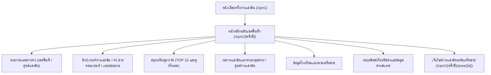
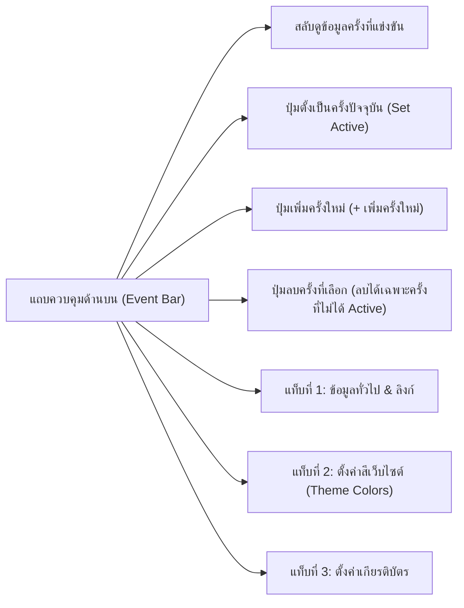

# คู่มือการใช้งานระบบบริหารจัดการงานศิลปหัตถกรรมนักเรียน (Sillapa Management System)

เอกสารฉบับนี้จัดทำขึ้นเพื่ออธิบายขั้นตอนการใช้งานระบบบริหารจัดการแข่งขันงานศิลปหัตถกรรมนักเรียน โดยแบ่งออกเป็น **ส่วนที่ 1: ระบบหน้าบ้าน (Frontend)** สำหรับผู้ใช้งานทั่วไป/ครู/นักเรียน และ **ส่วนที่ 2: ระบบหลังบ้าน (Backend)** สำหรับเจ้าหน้าที่แต่ละระดับ รวมถึง **ส่วนที่ 3: การติดตั้งและย้ายระบบไปยัง Host อื่น**

---

## ภาพรวมโครงสร้างระบบและ URL (Multi-Event Architecture)

ระบบรองรับการจัดเก็บและแสดงผลข้อมูลแยกตาม **ครั้งที่จัดการแข่งขัน (`eventNumber`)** และ **ปีการศึกษา (`academic_year`)** โดยแยกออกเป็น 2 ระดับหลักในการแข่งขัน:
1. **ระดับเครือข่ายสถานศึกษา (`/cpn1/{ครั้งที่}/area/{รหัสเครือข่าย}`)** — ใช้สำหรับคัดเลือกตัวแทนในระดับกลุ่มเครือข่ายโรงเรียน
2. **ระดับเขตพื้นที่การศึกษา (`/cpn1/{ครั้งที่}`)** — ใช้สำหรับแข่งขันระดับเขตพื้นที่การศึกษา (สามารถดึงตัวแทนที่ได้อันดับชนะเลิศจากระดับเครือข่ายขึ้นมาแข่งขันต่อได้)

| ประเภทหน้าเว็บ | ตัวอย่าง URL | คำอธิบาย |
| :--- | :--- | :--- |
| **หน้าเลือกครั้งการแข่งขัน** | `/cpn1` หรือ `/` | หน้า Landing Page สำหรับเลือกครั้งการแข่งขัน (เช่น ครั้งที่ 73, ครั้งที่ 74) |
| **หน้าหลักระดับเขตพื้นที่ฯ** | `/cpn1/74` | หน้าแรกของงานศิลปหัตถกรรมนักเรียน ครั้งที่ 74 (ระดับเขตพื้นที่ฯ) |
| **หน้าหลักระดับเครือข่าย** | `/cpn1/74/area/1` | หน้าแรกของการแข่งขันระดับเครือข่ายสถานศึกษา (แยกตามรหัสเครือข่าย) |
| **หน้าเข้าสู่ระบบ (Login)** | `/cpn1/74/login` | หน้าเข้าสู่ระบบสำหรับเจ้าหน้าที่ โรงเรียน ศูนย์แข่งขัน และผู้ดูแลระบบ |

> **กฎการป้องกันข้อมูลย้อนหลัง (Read-Only Archive Mode):**
> - ครั้งการแข่งขันที่ตั้งสถานะเป็น **Active (กำลังใช้งาน)** เท่านั้นที่จะสามารถเพิ่ม/แก้ไข/ลบข้อมูลได้
> - ครั้งการแข่งขันที่ไม่ได้ Active (ปีเก่า) ผู้ใช้และผู้ดูแลระบบสามารถเปิดดูข้อมูลย้อนหลังและพิมพ์เกียรติบัตรได้ตามปกติ แต่ระบบจะ **ล็อกห้ามแก้ไขหรือลบข้อมูล** เพื่อรักษาความถูกต้องของข้อมูลประวัติการแข่งขัน

---

# ส่วนที่ 1: คู่มือการใช้งานระบบหน้าบ้าน (Frontend)
*สำหรับนักเรียน ครู ผู้บริหารสถานศึกษา และผู้สนใจทั่วไป (ไม่ต้องเข้าสู่ระบบ)*



### 1.1 การเลือกครั้งการแข่งขัน
- เมื่อเข้าสู่หน้าแรกของเว็บไซต์ (`/cpn1`) ระบบจะแสดงรายการครั้งการแข่งขันทั้งหมดที่มีในระบบ
- คลิกเลือกครั้งการแข่งขันที่ต้องการรับชม (ครั้งที่เป็น **Active** จะแสดงป้ายสถานะกำลังดำเนินการ)

### 1.2 การติดตามข่าวสารและเอกสารสำคัญ
1. **ลิงก์และเอกสารสำคัญ (หน้าแรก):**
   - **เกณฑ์การแข่งขัน:** คลิกลิงก์เพื่อเปิดดูไฟล์เกณฑ์การแข่งขันประจำปี
   - **สอบถาม AI เรื่องเกณฑ์:** คลิกลิงก์เพื่อใช้งานระบบ AI (NotebookLM) สำหรับค้นหาและถาม-ตอบรายละเอียดเกณฑ์การแข่งขัน
   - **แบบสอบถามความพึงพอใจ:** คลิกหรือสแกน QR Code เพื่อทำแบบสอบถามออนไลน์
2. **ข่าวประชาสัมพันธ์:**
   - แยกแสดงผลชัดเจนระหว่าง **"ประกาศจากเขตพื้นที่การศึกษา"** และ **"ประกาศจากศูนย์การแข่งขัน"**
   - รายการที่เพิ่งประกาศภายใน 3 ชั่วโมงจะมีป้าย `NEW` แจ้งเตือน คลิกที่หัวข้อเพื่ออ่านรายละเอียดและดาวน์โหลดไฟล์แนบ (PDF / รูปภาพ)

### 1.3 การตรวจสอบรายการแข่งขัน สถานที่ และผลการแข่งขัน
ผู้เข้าชมสามารถตรวจสอบข้อมูลการแข่งขันได้ 4 ช่องทางจากหน้าแรก:
1. **ผลการแข่งขันล่าสุด:** แสดงรายการที่เพิ่งประกาศผลล่าสุดแบบ Real-time
2. **ผลการแข่งขันตามกลุ่มสาระการเรียนรู้ (`/cpn1/{ครั้งที่}/viewactivity/{รหัสกลุ่มสาระ}`):**
   - แสดงจำนวนรายการทั้งหมด จำนวนทีม และจำนวนรายการที่แข่งขันเสร็จสิ้น
   - เมื่อคลิกเข้าไปในกลุ่มสาระ จะพบรายชื่อกิจกรรม ช่วงชั้น จำนวนทีม สถานที่/ห้องแข่งขัน วันที่/เวลาแข่งขัน และสถานะการประกาศผล
   - คลิกที่ชื่อกิจกรรม (`/cpn1/{ครั้งที่}/viewactivitydetail/{รหัสกิจกรรม}`) เพื่อดูรายชื่อโรงเรียน คะแนนที่ได้ ระดับเหรียญรางวัล และอันดับที่ได้รับ
3. **ศูนย์การแข่งขัน (`/cpn1/{ครั้งที่}/viewbranch/{รหัสศูนย์}`):**
   - ดูรายการแข่งขันทั้งหมดที่อยู่ในความรับผิดชอบของแต่ละศูนย์การแข่งขัน พร้อมสถิติจำนวนกิจกรรม นักเรียน ครู และกรรมการ
4. **จำนวนโรงเรียนในเครือข่าย (`/cpn1/{ครั้งที่}/showschool/{รหัสเครือข่าย}`):**
   - คลิกที่ชื่อเครือข่ายเพื่อดูรายชื่อโรงเรียนในสังกัด และคลิกที่ชื่อโรงเรียน (`/cpn1/{ครั้งที่}/showschooldetail/{รหัสโรงเรียน}/{รหัสเครือข่าย}`) เพื่อดูสรุปเหรียญรางวัลทั้งหมดของโรงเรียนนั้นๆ พร้อมปุ่ม **Export Excel** และปุ่ม **พิมพ์เกียรติบัตรรายทีม**

### 1.4 สรุปเหรียญรางวัล (Medal Standings)
- หน้าแรกแสดงตาราง **สรุปเหรียญรางวัล TOP 10**
- คลิกปุ่ม **"ดูทั้งหมด"** (`/cpn1/{ครั้งที่}/viewall`) เพื่อดูตารางสรุปเหรียญรางวัลรวมทุกโรงเรียน (ทอง, เงิน, ทองแดง, รวม) พร้อมช่องค้นหาและเรียงลำดับข้อมูล

### 1.5 เมนู "ข้อมูลสารสนเทศ" และการพิมพ์เกียรติบัตร (เมนูด้านบน)
คลิกที่เมนู **ข้อมูลสารสนเทศ** บนแถบเมนูด้านบน (Navbar):
- **Print อันดับ 1-3 (`/showall_print`):** รายงานสรุปผลการแข่งขันเฉพาะทีมที่ได้อันดับ 1–3
- **Print รายชื่อทั้งหมด (`/showall_print2`):** รายงานผลการแข่งขันทุกทีมในระบบ
- **Print รายชื่อโรงเรียน (`/showall_print3`):** รายงานข้อมูลสถานศึกษาที่เข้าร่วม
- **Print รายชื่อกิจกรรม (`/showall_print6`):** รายงานรายการแข่งขันทั้งหมด
- **เกียรติบัตร (`/report`):**
  - พิมพ์เกียรติบัตรสำหรับ **นักเรียน / ครูผู้ฝึกสอน** (เลือกตามกลุ่มสาระและกิจกรรม)
  - พิมพ์เกียรติบัตรสำหรับ **คณะกรรมการตัดสิน** และ **คณะกรรมการดำเนินงาน** (เลือกพิมพ์ได้ทั้งแบบ **มีพื้นหลัง** และ **ไม่มีพื้นหลัง** สำหรับพิมพ์ลงกระดาษเกียรติบัตรจริง)

### 1.6 หน้าบ้านระดับเครือข่ายสถานศึกษา (`/cpn1/{ครั้งที่}/area/{รหัสเครือข่าย}`)
- เข้าถึงได้จากส่วน **"เว็บไซต์การแข่งขันระดับเครือข่าย"** บนหน้าแรกของระดับเขตพื้นที่ฯ
- มีโครงสร้างการใช้งานเหมือนระดับเขตพื้นที่ฯ ทุกประการ (ข่าวประกาศเครือข่าย, ผลล่าสุดของเครือข่าย, สรุปเหรียญ TOP 10 ของเครือข่าย, ผลตามกลุ่มสาระ, และการพิมพ์เกียรติบัตรระดับเครือข่าย)

---

# ส่วนที่ 2: คู่มือการใช้งานระบบหลังบ้าน (Backend)
*สำหรับผู้รับผิดชอบแต่ละฝ่าย (ต้องเข้าสู่ระบบที่ `/cpn1/{ครั้งที่}/login`)*

## 2.1 สิทธิ์การใช้งานและบทบาทผู้ใช้ (`users.position`)

ระบบแบ่งสิทธิ์การเข้าถึงเมนูหลังบ้านตามค่า `position` ของผู้ใช้งานดังนี้:

| รหัส `position` | บทบาทหน้าที่ | ขอบเขตการจัดการหลัก |
| :---: | :--- | :--- |
| **`0`** | **ผู้ใช้งานระดับโรงเรียน** | ลงทะเบียนส่งรายชื่อนักเรียน/ครูผู้ฝึกสอนในระดับเครือข่าย และพิมพ์บัตรประจำตัวผู้เข้าแข่งขัน |
| **`1`** | **เจ้าหน้าที่ศูนย์การแข่งขัน / บันทึกคะแนน** | บันทึกคะแนน/ผลการแข่งขัน, จัดการรายชื่อกรรมการตัดสิน/กรรมการดำเนินงาน, พิมพ์เอกสารหน้าห้องสอบ และประกาศข่าวศูนย์แข่งขัน |
| **`5`** | **ผู้ดูแลระดับเครือข่ายสถานศึกษา** | บริหารจัดการข้อมูลระดับเครือข่ายทั้งหมด (นักเรียน, กรรมการ, ผลคะแนน, ตั้งค่าเกียรติบัตรเครือข่าย, ผู้ใช้ในเครือข่าย) และแก้ไขชื่อนักเรียนตัวแทนระดับเขต |
| **`10`** | **ผู้ดูแลระบบสูงสุด (Super Admin)** | บริหารจัดการระบบทั้งหมด ทั้งการตั้งค่าครั้งการแข่งขัน, สีเว็บไซต์, เปิด-ปิดระบบ, ดึงตัวแทนจากเครือข่ายมาระดับเขต และจัดการข้อมูลพื้นฐาน |

---

## 2.2 คู่มือสำหรับผู้ใช้งานระดับโรงเรียน (`position = 0`)

1. **การเข้าสู่ระบบและการสมัครใช้งาน:**
   - เข้าสู่ระบบที่ `/cpn1/{ครั้งที่}/login` (หรือลงทะเบียนผู้ใช้ใหม่ที่ `/cpn1/{ครั้งที่}/myreg` โดยเลือกเครือข่ายและโรงเรียนของตน)
2. **การส่งรายชื่อนักเรียนและครูผู้ฝึกสอนเข้าแข่งขัน (ระดับเครือข่าย):**
   - คลิกเมนูโปรไฟล์มุมขวาบน เลือก **"เว็บระดับเครือข่าย"** -> **"บันทึกรายชื่อนักเรียน"** (`/area/areasubjectgroup/{รหัสเครือข่าย}`)
   - เลือกกลุ่มสาระการเรียนรู้ -> เลือกกิจกรรมที่ต้องการส่งเข้าแข่งขัน
   - กดเพิ่มทีมโรงเรียนของตน แล้วเพิ่มรายชื่อ **นักเรียน** และ **ครูผู้ฝึกสอน** ตามจำนวนที่เกณฑ์กำหนด (พร้อมอัปโหลดรูปถ่ายนักเรียน/ครูเพื่อใช้บนบัตรประจำตัว)
   - *หมายเหตุ:* สามารถเพิ่ม/แก้ไขได้เฉพาะในช่วงเวลาที่ผู้ดูแลเปิดระบบลงทะเบียนเท่านั้น
3. **การพิมพ์บัตรประจำตัวผู้เข้าแข่งขัน:**
   - สำหรับการแข่งขันระดับเครือข่าย: เลือกเมนู **"พิมพ์บัตร"** (`/shoolPrintCardArea`)
   - สำหรับการแข่งขันระดับเขตพื้นที่ฯ: เลือกเมนู **"พิมพ์บัตร"** (`/shoolPrintCard`)

---

## 2.3 คู่มือสำหรับเจ้าหน้าที่ศูนย์การแข่งขัน / บันทึกคะแนน (`position = 1` และ `10`)

เข้าถึงผ่านเมนูโปรไฟล์มุมขวาบน:

### 1) บันทึกผลการแข่งขัน (`/centersillapa`)
1. เลือกกลุ่มสาระการเรียนรู้ที่รับผิดชอบ -> คลิกเข้าดูรายการกิจกรรม (`/centerviewactivity/{รหัสกลุ่มสาระ}`)
2. คลิกที่ชื่อกิจกรรมเพื่อเข้าสู่หน้าบันทึกคะแนน (`/centerviewactivityschool/{รหัสกิจกรรม}`):
   - กรอก **คะแนนที่ได้** (ระบบคำนวณระดับเหรียญรางวัลอัตโนมัติ: `80-100` = ทอง, `70-79.99` = เงิน, `60-69.99` = ทองแดง, `1-59.99` = เข้าร่วม)
   - กำหนดอันดับ (`ชนะเลิศ`, `รองชนะเลิศอันดับ 1`, `รองชนะเลิศอันดับ 2`)
   - สามารถคลิกแก้ไขชื่อ-นามสกุลนักเรียน/ครูที่สะกดผิดได้ที่หน้า `/centereditstudent/{รหัสทีม}`
3. เมื่อตรวจสอบคะแนนครบถ้วนแล้ว กดบันทึกและเปลี่ยนสถานะกิจกรรมเป็น **"ประกาศผลแล้ว"** เพื่อแสดงผลขึ้นหน้าเว็บไซต์ทันที
4. สามารถแก้ไขรายละเอียดสถานที่/ห้องแข่งขัน/วันเวลาของกิจกรรมได้ที่ปุ่มแก้ไขกิจกรรม (`/centereditactiviy/{รหัสกิจกรรม}`)

### 2) จัดการกรรมการตัดสิน (`/jow`) และกรรมการดำเนินงาน (`/addjow2`)
- **กรรมการตัดสิน (`/jow`):** เลือกกลุ่มสาระ -> เลือกกิจกรรม (`/addjow/{รหัสกิจกรรม}`) -> เพิ่ม/แก้ไข/ลบรายชื่อกรรมการตัดสินประจำกิจกรรม และกดพิมพ์เกียรติบัตรกรรมการได้ทันที
- **กรรมการดำเนินงาน (`/addjow2`):** เพิ่ม/แก้ไข/ลบรายชื่อคณะกรรมการดำเนินงานประจำศูนย์แข่งขัน พร้อมปุ่มพิมพ์เกียรติบัตร

### 3) พิมพ์เอกสารประจำห้องแข่งขัน (`/printpointdoc`)
ในหน้ารายการกิจกรรมของศูนย์แข่งขัน (`/centerviewactivity/{id}`) หรือเมนู **พิมพ์เอกสาร** สามารถสั่งพิมพ์เอกสาร PDF สำหรับใช้ในวันแข่งขันได้ครบชุด:
- ใบลงทะเบียนนักเรียน (`/studentregisterform/{รหัสกิจกรรม}`)
- ใบลงทะเบียนครูผู้ฝึกสอน (`/teacherregisterform/{รหัสกิจกรรม}`)
- ใบลงทะเบียนกรรมการตัดสิน (`/jowregisterform/{รหัสกิจกรรม}`)
- ใบจับฉลากลำดับการแข่งขัน (`/showprintrandomz/{รหัสกิจกรรม}`)
- แบบฟอร์มใบให้คะแนนกรรมการ (`/showprintpointdoc/{รหัสกิจกรรม}`)
- แบบฟอร์มคิดเลขเร็ว (`/printspeedmath/{รหัสกิจกรรม}`) และใบสรุปผลหน้าห้องสอบ (`/printtop/{รหัสกิจกรรม}`)

### 4) เพิ่มประกาศศูนย์การแข่งขัน (`/shownotice`)
- สร้างประกาศแจ้งเตือนผู้เข้าแข่งขัน (เช่น แจ้งเปลี่ยนห้องสอบ, แจ้งตารางเวลา, แนบไฟล์ PDF หรือรูปภาพแผนผังสนามสอบ)

---

## 2.4 คู่มือสำหรับผู้ดูแลระดับเครือข่ายสถานศึกษา (`position = 5`)

เมื่ออยู่ในหน้าเว็บระดับเครือข่าย (`/cpn1/{ครั้งที่}/area/{รหัสเครือข่าย}`) คลิกที่เมนูโปรไฟล์มุมขวาบน จะพบเครื่องมือจัดการเฉพาะของเครือข่ายตนเอง:
1. **บันทึกข้อมูลนักเรียน / บันทึกผลการแข่งขัน / ยกเลิกผลการแข่งขัน (`/area/areasubjectgroup/{รหัสเครือข่าย}`):**
   - จัดการทีมโรงเรียน รายชื่อนักเรียน/ครู บันทึกคะแนน และประกาศผลการแข่งขันในระดับเครือข่าย
2. **บันทึกรายชื่อกรรมการตัดสิน (`/areajow`) และกรรมการดำเนินงาน (`/area/addjow2`):**
   - จัดการรายชื่อคณะกรรมการในระดับเครือข่าย
3. **เพิ่มประกาศแจ้งผู้เข้าร่วมแข่งขัน (`/area/shownotice`):**
   - ประกาศข่าวสารเฉพาะในหน้าเว็บของเครือข่ายตนเอง
4. **การตั้งค่าระบบระดับเครือข่าย (`/area/areaconfig`):**
   - ตั้งค่าชื่องานระดับเครือข่าย, วันที่จัดการแข่งขัน, อัปโหลดรูปโลโก้เครือข่าย, อัปโหลดไฟล์พื้นหลังเกียรติบัตรของเครือข่าย และตั้งค่าเลขที่เอกสาร/วันออกเกียรติบัตรระดับเครือข่าย
5. **จัดการข้อมูลผู้ใช้งานในเครือข่าย (`/area/areauser`):**
   - ตรวจสอบและจัดการบัญชีผู้ใช้ของโรงเรียนในสังกัดเครือข่าย
6. **แก้ไขนักเรียนระดับเขต (`/subjectgroup` บนหน้าเว็บระดับเขต):**
   - ใช้สำหรับตรวจสอบหรือแก้ไขรายชื่อนักเรียนที่เป็นตัวแทนของเครือข่ายตนเองไปแข่งขันต่อในระดับเขตพื้นที่การศึกษา

---

## 2.5 คู่มือสำหรับผู้ดูแลระบบสูงสุด — Super Admin (`position = 10`)

ผู้ดูแลระบบสูงสุดสามารถเข้าถึงเมนู **Super Admin Control** และ **Competition Config** ได้ทั้งหมดดังนี้:

### 1) การตั้งค่าระบบและบริหารจัดการครั้งการแข่งขัน (`/cpn1/{ครั้งที่}/config`)
หน้าตั้งค่าระบบรูปแบบใหม่ แบ่งการทำงานออกเป็นส่วนควบคุมด้านบน และแท็บตั้งค่า 3 แท็บ:



- **แถบควบคุมครั้งการแข่งขัน (ด้านบนสุด):**
  - **สลับครั้งการแข่งขัน:** เลือกดูข้อมูลการตั้งค่าของแต่ละครั้งได้ทันที หากเลือกดูครั้งที่ไม่ได้ Active ระบบจะแสดงโหมด **ดูข้อมูลเท่านั้น (Read-Only)** เพื่อป้องกันการแก้ไขข้อมูลปีเก่าโดยไม่ตั้งใจ
  - **ตั้งเป็นครั้งปัจจุบัน (Active):** กดเพื่อสลับให้ครั้งการแข่งขันที่เลือกเป็นครั้งหลักของระบบ (มีหน้าต่างยืนยันแบบ Custom Modal)
  - **เพิ่มครั้งใหม่:** สร้างครั้งการแข่งขันใหม่ พร้อมระบุครั้งที่ ปี พ.ศ. และชื่องาน
  - **ลบครั้งที่เลือก:** ลบครั้งการแข่งขันที่ไม่ได้ใช้งาน (ระบบไม่อนุญาตให้ลบครั้งที่กำลัง Active อยู่)
- **แท็บที่ 1: ข้อมูลทั่วไป & ลิงก์ (General & Links):**
  - ตั้งค่าชื่องานการแข่งขัน, คำขวัญ (Slogan), ระดับการแข่งขัน, ชื่อหน่วยงานเขตพื้นที่ฯ, ปี พ.ศ.
  - อัปโหลดโลโก้ประจำงาน (รองรับการ Crop รูปภาพในตัว)
  - ตั้งค่าลิงก์เกณฑ์การแข่งขัน, ลิงก์ AI, ลิงก์แบบสอบถามความพึงพอใจ และอัปโหลดรูป QR Code
- **แท็บที่ 2: ตั้งค่าสีเว็บไซต์ (Theme Colors):**
  - ตั้งค่า **สีหลัก (Primary Color)** และ **สีรอง (Secondary Color)** แยกอิสระในแต่ละครั้งการแข่งขัน (เช่น ครั้งที่ 73 ใช้โทนสีเขียว, ครั้งที่ 74 ใช้โทนสีแดงกุหลาบ)
  - มีชุดสีสำเร็จรูป (Preset Palettes) ให้เลือกคลิกใช้งานได้ทันที พร้อมตัวอย่างแสดงผลจริง (Live Preview) ก่อนกดบันทึก
- **แท็บที่ 3: ตั้งค่าเกียรติบัตร (Certificate Settings):**
  - อัปโหลดรูปพื้นหลังเกียรติบัตรของแต่ละหน่วย (เขตพื้นที่ฯ และเครือข่าย)

### 2) ปิด/เปิดระบบบันทึกข้อมูล (`/systemactive`)
- ควบคุมการเปิด-ปิดระบบย่อยแต่ละส่วน เช่น:
  - เปิด/ปิดการลงทะเบียนนักเรียน
  - เปิด/ปิดการแก้ไขรายชื่อนักเรียน/ครู
  - เปิด/ปิดการบันทึกคะแนนของศูนย์การแข่งขัน
  - เปิด/ปิดการพิมพ์เกียรติบัตร

### 3) ดึงข้อมูลตัวแทนจากเครือข่ายมาระดับเขต (`/datatranfer`) และสำรองข้อมูล
- **ดึงข้อมูลจากเครือข่าย:** ดึงรายชื่อทีมโรงเรียน นักเรียน และครูผู้ฝึกสอนที่ได้เป็นตัวแทนจากระดับเครือข่าย (`addschools_areas`, `addstudents_areas`) เข้าสู่ตารางการแข่งขันระดับเขตพื้นที่ฯ (`addschools`, `addstudents`) พร้อมแถบแสดงความคืบหน้า (Progress Bar)
- **สำรองข้อมูล (Backup) และล้างข้อมูล:** มีระบบสำรองฐานข้อมูลก่อนดำเนินการเพื่อความปลอดภัย

### 4) คัดลอกข้อมูลโครงสร้างข้ามปี (`/copy-data`)
- ใช้สำหรับคัดลอกข้อมูลโครงสร้างการแข่งขัน (เช่น กลุ่มสาระการเรียนรู้, รายการกิจกรรม, ศูนย์การแข่งขัน, วันที่จัดการแข่งขัน) จากปีการศึกษาเก่าไปยังปีการศึกษาใหม่โดยไม่ต้องกรอกใหม่ทั้งหมด

### 5) การจัดการข้อมูลพื้นฐาน (Master Data & Competition Config)
- **จัดการคำนำหน้า (`/title`):** เพิ่ม/แก้ไขคำนำหน้าชื่อ (ด.ช., ด.ญ., นาย, นางสาว ฯลฯ)
- **จัดการข้อมูลผู้ใช้ (`/myuser`):** เพิ่ม/แก้ไข/ลบผู้ใช้งาน กำหนดสิทธิ์ (`position`) ผูกศูนย์การแข่งขัน (`branch`) หรือเครือข่าย (`schoolgroup`)
- **จัดการข้อมูลศูนย์แข่งขัน (`/branch`):** เพิ่ม/แก้ไขรายชื่อศูนย์การแข่งขันประจำปี
- **จัดการเครือข่ายสถานศึกษา (`/schoolgroup`) และโรงเรียน (`/school`):** จัดการข้อมูลกลุ่มเครือข่ายและสถานศึกษาในสังกัด
- **จัดการประกาศ (`/Notice`):** จัดการข่าวประชาสัมพันธ์ทั้งหมดในระบบ
- **จัดการช่วงชั้น (`/class`), รายวิชา (`/subjectgroup`), รายการแข่งขัน (`/activity`), วันการแข่งขัน (`/dayofsillapa`):** กำหนดรายการแข่งขัน เกณฑ์จำนวนนักเรียน/ครูต่อทีม จำนวนทีมสูงสุดต่อโรงเรียน และผูกกิจกรรมเข้ากับศูนย์การแข่งขัน

---

# ส่วนที่ 3: คู่มือการติดตั้งและย้ายระบบไปยัง Host อื่น (Deployment & Migration)

ระบบได้รับการออกแบบให้สามารถย้ายไปยังเครื่องแม่ข่าย (Host) อื่นได้ทั้งบน **Windows (IIS)** และ **Linux (Apache / LiteSpeed / Nginx)** โดยรักษาข้อมูลเดิมทั้งหมด 100%

### ขั้นตอนการย้ายระบบ
1. **คัดลอกไฟล์ระบบทั้งหมดไปยัง Host ใหม่:**
   - คัดลอกโฟลเดอร์โปรเจกต์ทั้งหมด (รวมถึงโฟลเดอร์ `storage/app/public` ซึ่งเก็บไฟล์รูปโลโก้, QR Code, ไฟล์แนบประกาศ และพื้นหลังเกียรติบัตรแยกตามปี พ.ศ.)
2. **นำเข้าฐานข้อมูล (กรณีมีฐานข้อมูลเดิม):**
   - Import ไฟล์ `.sql` ของฐานข้อมูลเดิมเข้าสู่ MySQL / MariaDB บน Host ใหม่ (หรือสร้างฐานข้อมูลเปล่ากรณีติดตั้งใหม่)
3. **ตั้งค่าไฟล์ `.env`:**
   - คัดลอกจาก `.env.example` เป็น `.env` (หรือแก้ไข `.env` เดิม) โดยปรับค่า `APP_URL`, `DB_HOST`, `DB_DATABASE`, `DB_USERNAME`, `DB_PASSWORD` ให้ตรงกับ Host ใหม่
4. **รันคำสั่ง Migration:**
   ```bash
   php artisan migrate
   ```
   > **ความปลอดภัยต่อข้อมูลเดิม:**
   > - คำสั่ง `php artisan migrate` จะตรวจสอบตารางและคอลัมน์ที่มีอยู่ก่อนเสมอ หากตารางหรือคอลัมน์ใดมีอยู่แล้วจะข้ามไปโดยไม่เกิด Error และ **ไม่มีการลบหรือเขียนทับข้อมูลเก่า**
   > - หากฐานข้อมูลเดิมมีข้อมูลจากปีการศึกษาเก่าที่ยังไม่ได้ผูก `event_id` ระบบจะสร้างรายการในตาราง `events` และเชื่อมโยง `event_id` ให้โดยอัตโนมัติพร้อมสร้างโฟลเดอร์ `storage/app/public/{year}/upload` และ `picture` ให้ครบทุกปี
5. **ตรวจสอบด้วยคำสั่งตรวจสอบสถานะและล้าง Cache (ทางเลือก):**
   ```bash
   php artisan sillapa:migrate-safe
   ```
   คำสั่งนี้จะรัน `migrate`, ตรวจสอบความสมบูรณ์ของการเชื่อมโยงข้อมูลทุกปี, ล้าง Cache ทั้งหมด (`optimize:clear`) และแสดงตารางสรุปจำนวนกิจกรรม/ทีมโรงเรียน/นักเรียนของแต่ละครั้งการแข่งขันบนหน้าจอทันที
